# 01 — Design Identity, Governance & Monitoring Solutions
> **Official Exam Weight: 25–30%**
> 📁 [← Back to Home](/az-305-study-notes/)

---

## 🗺 Domain Overview

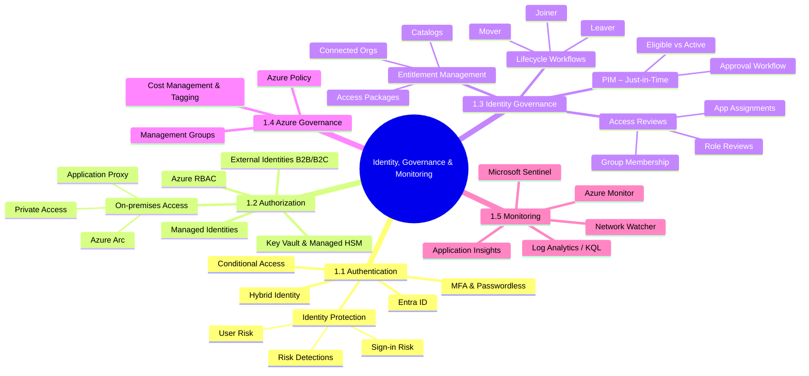

---

## 🔐 1.1 Design Authentication Solutions

### Microsoft Entra ID (formerly Azure AD)

**Core Concepts:**

- 🏢 A **Tenant** = one dedicated Entra ID instance per organisation
- 👤 **User** = human identity | **Group** = collection of users
- 🤖 **Service Principal** = non-human app identity (requires secret or cert)
- ✅ **Managed Identity** = auto-managed service principal for Azure resources (no secret needed)
- 🔗 **App Registration** = registers an app in Entra ID to use OAuth/OIDC

### Hybrid Identity — Decision Flow

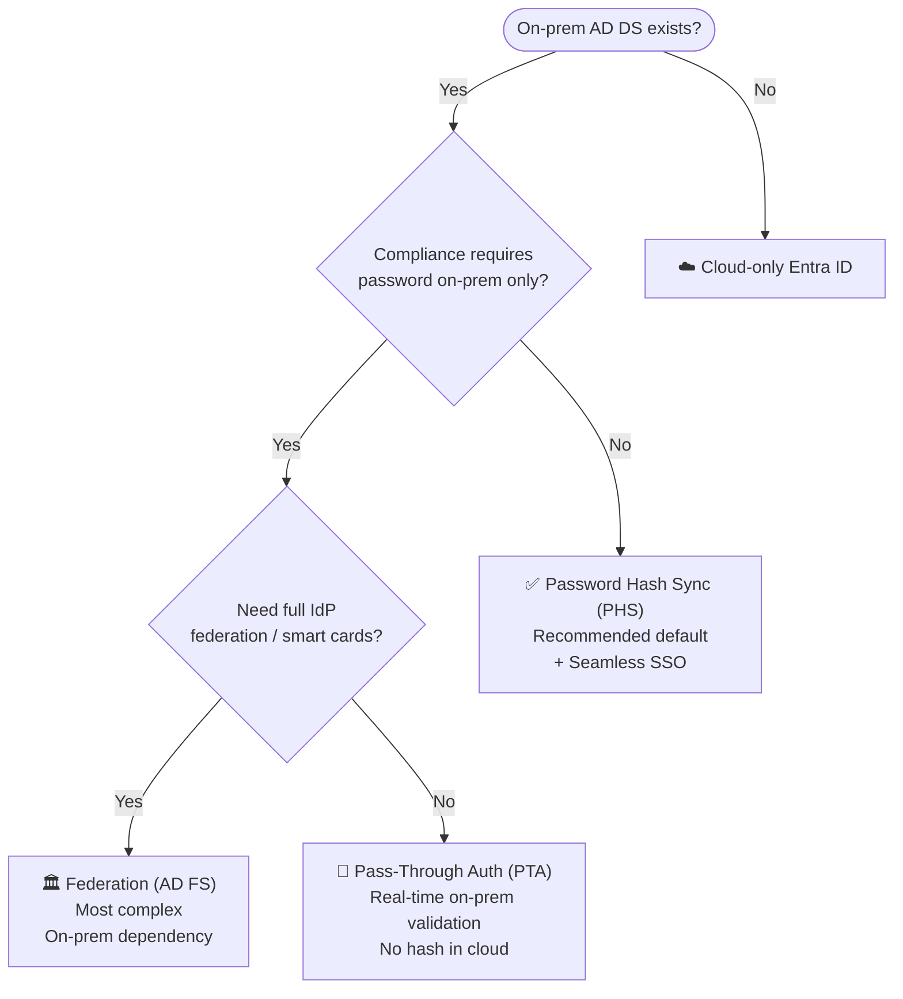

| Method | Password Location | Online Dependency | Best For |
|--------|-----------------|-------------------|---------|
| **PHS** *(Recommended)* | Hash synced to cloud | Works even if on-prem is down | Most organisations |
| **PTA** | On-premises only | Requires on-prem agent | Compliance: no hash in cloud |
| **Federation (AD FS)** | On-premises IdP | Requires AD FS farm | Smart cards, complex claims |

> **Exam Caveats ⚠️:**
> - PHS is the **Microsoft-recommended** default — it's resilient (works even if on-prem is down)
> - PTA requires **at least 3 agents** for HA — failure of all agents = login failure
> - **Seamless SSO** works with both PHS and PTA — auto-signs in users on domain-joined devices

---

### Multi-Factor Authentication (MFA)

**Authentication factors ranked by strength:**

| # | Factor Type | Example | Strength |
|---|-------------|---------|---------|
| 1 | Something you **are** + **have** | FIDO2 Security Key | 🔒🔒🔒🔒🔒 (Strongest) |
| 2 | Something you **are** (biometric) | Windows Hello for Business | 🔒🔒🔒🔒🔒 |
| 3 | Something you **have** (app) | Microsoft Authenticator (passwordless) | 🔒🔒🔒🔒 |
| 4 | Certificate-based Auth | Smart card / PIV | 🔒🔒🔒🔒 |
| 5 | App OTP | Authenticator app TOTP | 🔒🔒🔒 |
| 6 | Hardware OATH token | OATH hardware token | 🔒🔒🔒 |
| 7 | Software OTP | Authenticator app code | 🔒🔒 |
| 8 | SMS / Voice call | SMS code to phone | 🔒 (Weakest) |

> **Exam Caveat ⚠️:** SMS and voice call MFA should be **avoided** for high-security scenarios — SIM swapping attacks. Exam scenarios should favour Authenticator App or FIDO2.

---

### Conditional Access

**The Conditional Access Policy model:**

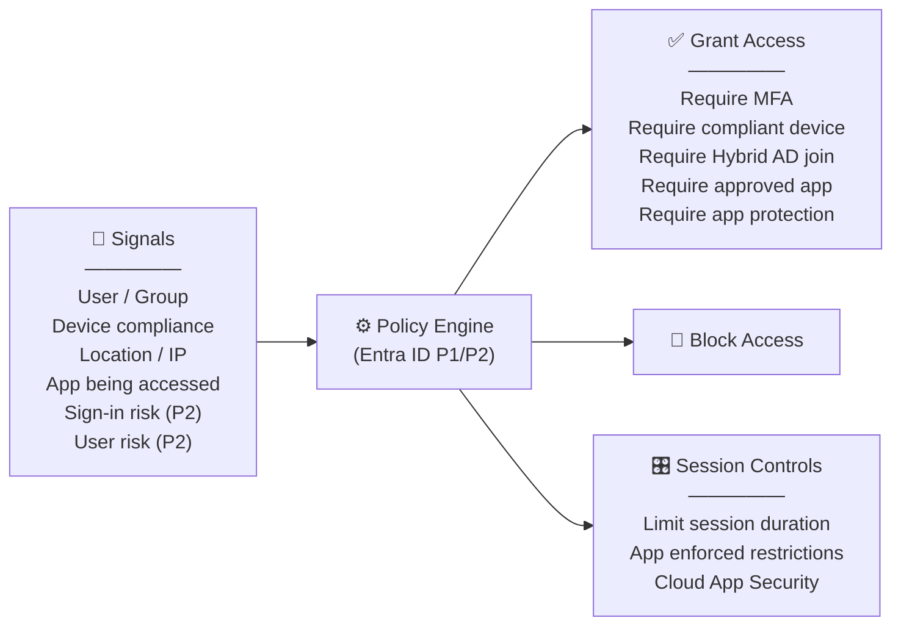

**Licence requirements:**

| Feature | Required Licence |
|---------|----------------|
| Basic Conditional Access policies | **Entra ID P1** |
| Named Locations, compliance conditions | **Entra ID P1** |
| Risk-based Conditional Access | **Entra ID P2** |
| Sign-in / User risk policies | **Entra ID P2** (part of Identity Protection) |

> **Exam Caveats ⚠️:**
> - **Sign-in risk** and **user risk** conditions require **P2** (Identity Protection)
> - **MFA registration policy** requires P2
> - Conditional Access evaluates **at sign-in time** — it doesn't revoke existing sessions immediately

---

### Entra ID Identity Protection

**What Identity Protection does:** Detects suspicious identity-related activity in real time, assigns a risk level to each event, and feeds those risk signals into Conditional Access policies for automated remediation.

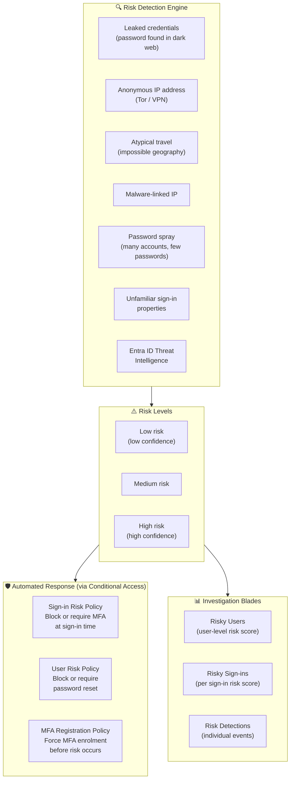

**Risk types — User Risk vs Sign-in Risk:**

| Dimension | User Risk | Sign-in Risk |
|-----------|-----------|-------------|
| **What it measures** | Cumulative risk on an account (e.g., leaked credential) | Risk of a specific authentication attempt |
| **Persists until** | Manually dismissed or remediated | Resolved at end of sign-in session |
| **Self-remediation** | Secure password change (if SSPR enabled) | Complete MFA challenge |
| **Admin action** | Dismiss user risk / confirm compromised | Dismiss / confirm sign-in |
| **CA condition** | `User risk` ≥ Low/Medium/High | `Sign-in risk` ≥ Low/Medium/High |

**Key risk detections to know:**

| Detection | Risk Type | Why It Matters |
|-----------|-----------|---------------|
| Leaked credentials | User risk | Password found in credential dump — almost always High |
| Anonymous IP | Sign-in risk | Tor exit node or anonymising proxy |
| Atypical travel | Sign-in risk | Sign-in from two locations impossible to travel between |
| Password spray | Sign-in / User risk | Broad low-volume attack across many accounts |
| Entra ID Threat Intel | Both | Microsoft's own threat intelligence feed |

> **Exam Caveats ⚠️:**
> - Identity Protection requires **Entra ID P2** — the risk detections page and automated policies are not available in P1
> - **Risk ≠ blocked**: by itself Identity Protection only *scores* risk. You need a **Conditional Access policy** with a risk condition to take action
> - Users can **self-remediate** without admin intervention if SSPR and MFA are enabled — this is the recommended path for sign-in risk
> - **Confirm compromised** escalates risk to High and triggers any CA policies at that level; **Dismiss** clears the risk without treatment

---

## 👤 1.2 Design Authorization Solutions

### Azure RBAC — Built-in Roles

| Role | Can Manage Resources | Can Manage Access | Can Assign Roles |
|------|---------------------|-------------------|-----------------|
| **Owner** | ✅ Full | ✅ Full | ✅ Yes |
| **Contributor** | ✅ Full | ❌ No | ❌ No |
| **Reader** | 👁️ View only | ❌ No | ❌ No |
| **User Access Administrator** | ❌ No | ✅ Full | ✅ Yes |

**Service-specific roles to know:**

| Role | Scope |
|------|-------|
| Network Contributor | Manage VNets, NSGs, route tables — no VM access |
| Virtual Machine Contributor | Manage VMs — no VNet or storage access |
| Storage Blob Data Contributor | Read/write/delete Blob containers and data |
| Key Vault Administrator | All data-plane operations on keys, secrets and certificates (can't assign roles) |
| Key Vault Secrets Officer | Manage secrets only (not keys or certs) |
| SQL DB Contributor | Manage SQL databases — not security policies |
| Monitoring Contributor | Read all monitoring data, edit monitoring settings |

> **Exam Caveats ⚠️:**
> - **Contributor ≠ Owner** — a Contributor cannot assign roles or manage access
> - To grant access to others, you need **Owner** or **User Access Administrator**
> - Custom roles are supported but rarely needed — know when built-ins fall short

### Managed Identities — Deep Dive

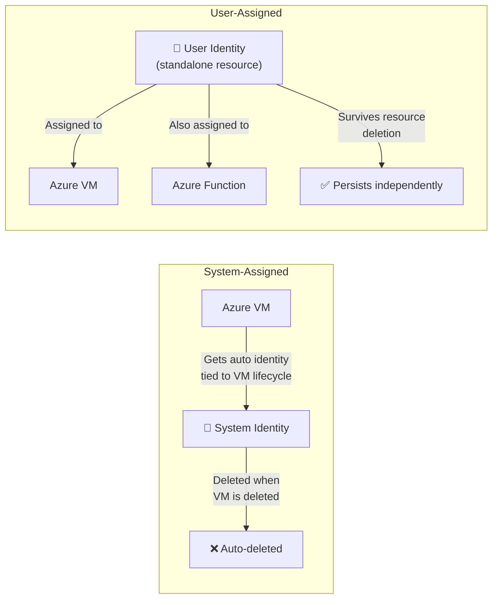

| Feature | System-Assigned | User-Assigned |
|---------|----------------|--------------|
| Lifecycle | Tied to the resource | Independent resource |
| Shared across resources | ❌ No | ✅ Yes |
| Created by | Enabling on a resource | Creating standalone resource |
| Best for | Single resource, simple use case | Multiple resources sharing same identity |

> **Exam Caveats ⚠️:**
> - Managed Identities can authenticate to **any service that supports Entra ID authentication**
> - Use **system-assigned** for simple single-resource scenarios
> - Use **user-assigned** when multiple resources need the same permissions or when the identity must survive resource deletion

### 🔑 Azure Key Vault — Choosing a Key Store

> 📋 **Study guide skill:** *Recommend a solution to manage secrets, certificates, and keys.* The Standard vs Premium tier basics are in [05 — Azure Key Vault Tiers](/az-305-study-notes/05-well-architected-framework/#azure-key-vault--tiers). This section covers the design decisions built on top of them.

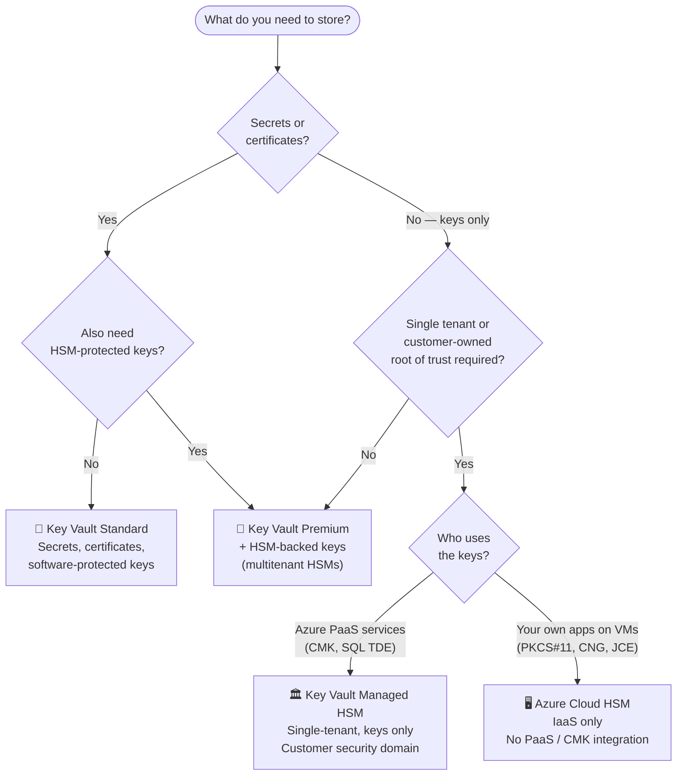

**Key store comparison:**

| Feature | Key Vault Standard | Key Vault Premium | Managed HSM | Azure Cloud HSM |
|---------|-------------------|-------------------|-------------|-----------------|
| Tenancy | Multitenant | Multitenant | **Single-tenant** | **Single-tenant** |
| Stores | Secrets, certificates, software keys | Standard + **HSM-backed keys** | **HSM keys only** — no secrets or certificates | Keys used through HSM APIs — not a secret store |
| FIPS validation | FIPS 140 Level 1 | **FIPS 140-3 Level 3** (HSM keys) | **FIPS 140-3 Level 3** | **FIPS 140-3 Level 3** |
| Root of trust | Microsoft | Microsoft | **Customer** (security domain) | **Customer** |
| Data-plane access control | Azure RBAC or access policies | Azure RBAC or access policies | **Managed HSM local RBAC** | HSM users you administer |
| Customer-managed keys for Azure PaaS | ✅ | ✅ | ✅ | ❌ (IaaS only) |
| Billing | Per operation | Per operation + monthly charge per HSM key | Fixed hourly rate | Fixed hourly rate |

> Premium HSM keys are FIPS 140-3 Level 3 when they're created on Microsoft's current HSM platform. Keys created on the older platform are FIPS 140-2 Level 2. For industry key-ownership requirements, such as Managed HSM with Customer Lockbox, see [07 — 7.6 Security & Identity Patterns](/az-305-study-notes/07-azure-architectures/#-76-security--identity-patterns).

> **Exam Caveats ⚠️:**
> - **Managed HSM stores keys only.** If the scenario also needs secrets or certificates, pair it with a Key Vault for those
> - **Azure Dedicated HSM is retiring.** It takes no new customers, and existing ones are supported until **July 31, 2028**. Its successor for IaaS and PKCS#11 workloads is **Azure Cloud HSM**. For customer-managed keys on Azure PaaS services, pick **Managed HSM**
> - **Azure Cloud HSM doesn't integrate with Azure PaaS.** It can't hold customer-managed keys for Storage, SQL or Disk Encryption
> - **If you lose the Managed HSM security domain, you lose every key in it** permanently. Microsoft can't recover it
> - Key Vault **Premium** uses shared, Microsoft-operated HSMs. Choose Managed HSM when the requirement says *single tenant*, *key sovereignty* or *customer-controlled root of trust*

### 🗝️ Key Vault — Access Control, Recovery & Rotation

**Access control — Azure RBAC vs access policies:**

| Dimension | Azure RBAC *(recommended)* | Vault access policies *(legacy)* |
|-----------|---------------------------|----------------------------------|
| Default for new vaults | ✅ In the portal, and with API version **2026-02-01** or later | Only if you set `enableRbacAuthorization` to `false` |
| Scope | Management group → subscription → resource group → vault → individual key, secret or certificate | Whole vault, per object type |
| Who can grant data access | Only **Owner** or **User Access Administrator** (role-assignment write) | Anyone with `vaults/write`, **Contributor** included, can edit the policies and grant themselves access |
| PIM just-in-time access | ✅ | ❌ |
| Deny assignments | ✅ | ❌ |

**Key Vault roles to know (Azure RBAC model):**

| Role | What It Allows | Typical Holder |
|------|---------------|---------------|
| **Key Vault Administrator** | All data-plane operations on keys, secrets and certificates. Can't assign roles | Vault administrators |
| **Key Vault Secrets User** | Read secret contents | An app's managed identity |
| **Key Vault Secrets Officer** | Manage secrets (not keys or certificates) | Secret owners |
| **Key Vault Crypto Service Encryption User** | Read key metadata, wrap and unwrap keys | The identity a service such as Storage or SQL uses for a customer-managed key |
| **Key Vault Certificates Officer** | Manage the certificate lifecycle | PKI team |
| **Key Vault Reader** | Read metadata only, never secret values | Auditors |
| **Key Vault Contributor** | **Control plane only**: manage the vault resource, with no access to keys, secrets or certificates | Platform team |

**Recovery — soft delete vs purge protection:**

| Feature | Soft Delete | Purge Protection |
|---------|------------|-----------------|
| Default | **Always on**, can't be disabled | **Off**, opt in |
| What it does | Keeps a deleted vault or object recoverable for the retention period | Blocks **purging** (permanent deletion) until the retention period ends, for everyone, Microsoft included |
| Retention | **7–90 days** (default 90), set **only when the vault is created** | Same interval as soft delete |
| Can it be turned off? | ❌ | ❌ Irreversible once enabled |
| Required for | — | Most customer-managed key integrations, such as Azure Storage |

**Rotation by object type:**

| Object | Built-in Rotation? | How It Works |
|--------|-------------------|-------------|
| **Keys** | ✅ Rotation policy | Creates a new key version on a schedule (7 days minimum) or on demand, with an optional near-expiry Event Grid event. Services that use the **versionless key URI** pick up the new version automatically |
| **Certificates** | ✅ Auto-renewal | Renews at a set percentage of lifetime or number of days before expiry, through an integrated CA (**DigiCert**, **GlobalSign**) or as self-signed. Event Grid raises `CertificateNearExpiry` 30 days before expiry |
| **Secrets** | ❌ Not built in | Event Grid raises `SecretNearExpiry` 30 days before expiry, and an **Azure Function** creates the new value and updates the target service (single- or dual-credential pattern) |

> **Exam Caveats ⚠️:**
> - **Azure RBAC is the recommended model.** From API version 2026-02-01 it's also the default for new vaults. Access policies are still supported, but they're legacy. All control-plane API versions older than 2026-02-01 retire on **February 27, 2027**
> - **Contributor or Key Vault Contributor doesn't grant access to secrets** under Azure RBAC. Data access needs a data-plane role such as Key Vault Secrets User
> - Managed HSM controls access to keys with its own **local RBAC** (for example, Managed HSM Crypto User). Azure RBAC covers only its control plane
> - **Purge protection is one-way.** While it's on, a deleted vault's name stays reserved until the retention period ends
> - The best secret to rotate is **no secret at all**. Use managed identities and Entra ID authentication wherever the target service supports them

### 🔗 Key Vault — Managed Identities & Key Vault References

Apps shouldn't hold credentials for Key Vault itself. They authenticate with a [managed identity](/az-305-study-notes/01-identity-governance-monitoring/#managed-identities--deep-dive) and get a data-plane role on the vault.

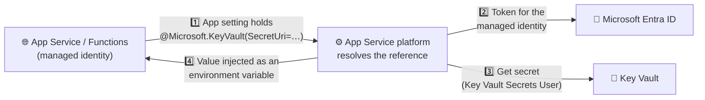

| Hosting | Pattern | Notes |
|---------|---------|-------|
| **App Service, Functions, Logic Apps (Standard)** | **Key Vault reference** in an app setting: `@Microsoft.KeyVault(SecretUri=https://<vault>.vault.azure.net/secrets/<name>/)` | No code change. A versionless reference picks up a rotated secret within **24 hours**, or straight away on restart or any configuration change |
| **AKS** | **Azure Key Vault provider for Secrets Store CSI Driver** | Mounts secrets into pods as files. Authenticates with Microsoft Entra Workload ID or a managed identity |
| **Any code (VMs, containers)** | Azure SDK with `DefaultAzureCredential` | Uses the managed identity in Azure and your developer credentials locally |
| **Many apps sharing configuration** | **App Configuration Key Vault reference** | See [04 — Azure App Configuration](/az-305-study-notes/04-infrastructure-solutions/#-azure-app-configuration--configuration-management) |

> **Exam Caveats ⚠️:**
> - Use a **user-assigned identity** (set `keyVaultReferenceIdentity`) when the app needs a secret at creation time, before a system-assigned identity exists
> - If the vault sits behind a firewall or private endpoint, give the app **VNet integration**. Don't allow-list the app's outbound IP addresses
> - When a reference can't be resolved, the app receives the literal `@Microsoft.KeyVault(...)` string. Check the reference status in the portal
> - Pinning a version in the reference (`.../secrets/<name>/<version>`) **stops the app picking up rotated secrets**

### 🏢 Authorizing Access to On-Premises Resources

> 📋 **Study guide skill:** *Recommend a solution for authorizing access to on-premises resources.* Synchronising on-premises AD DS accounts into Entra ID is covered in [Hybrid Identity — Decision Flow](/az-305-study-notes/01-identity-governance-monitoring/#hybrid-identity--decision-flow). This section is about reaching and authorising on-premises apps and servers with those identities.

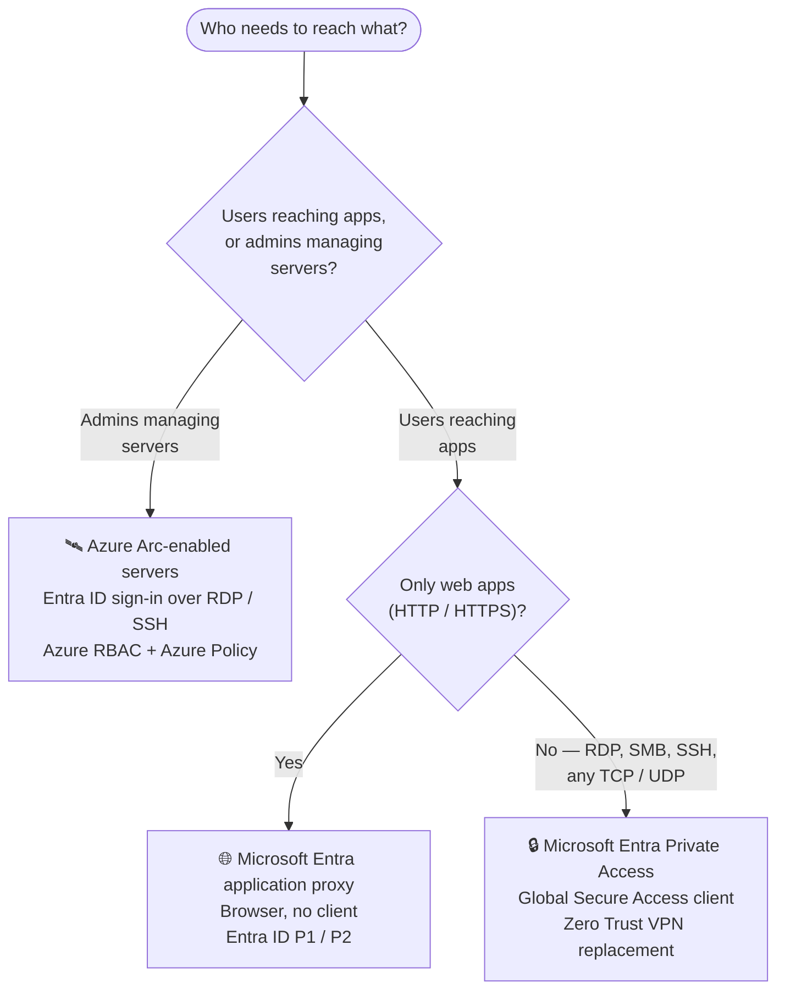

| Dimension | Entra application proxy | Entra Private Access | Azure Arc-enabled servers |
|-----------|------------------------|----------------------|--------------------------|
| Protects | On-premises **web apps** (HTTP/HTTPS) | **Any** private resource: FQDNs or IP ranges on any TCP/UDP port | **Admin access** to on-premises and multicloud servers |
| User experience | Browser or My Apps, no client | **Global Secure Access client** on the device | RDP or SSH with Entra ID credentials |
| On-premises component | **Private network connector**, outbound-only | The **same** private network connector | Azure Connected Machine agent |
| Authorisation | Enterprise app assignment + Conditional Access | Quick Access or per-app assignment + Conditional Access | Azure RBAC: **Virtual Machine Administrator Login** or **Virtual Machine User Login** |
| SSO to the app | Kerberos constrained delegation, header-based, SAML, password-based | Kerberos SSO across private apps | — |
| Licence | **Entra ID P1 or P2** | **Microsoft Entra Private Access** (also in **Microsoft Entra Suite**) | Core Arc features at no extra cost. Add-on services are billed |

> **Exam Caveats ⚠️:**
> - **application proxy and Private Access share one connector**, the Microsoft Entra private network connector (formerly the application proxy connector). It makes outbound connections only, so you open no inbound firewall ports. Put at least **two connectors** in each connector group for high availability
> - **application proxy is for remote users** and publishes web apps only. It isn't meant for users on the corporate network. For RDP, SMB or other non-HTTP protocols, the answer is **Private Access**
> - Microsoft recommends starting with **Quick Access** to replace the VPN, then moving to **per-app access** for segmentation
> - **Owner or Contributor on an Arc-enabled server doesn't let you sign in to it.** You need Virtual Machine Administrator Login or Virtual Machine User Login
> - Entra ID sign-in to Arc-enabled **Windows** servers needs Windows Server 2025 (or Windows 11 24H2) and **Entra-joins** the machine, so it's not for servers joined to on-premises AD DS. **Linux** servers use SSH with the `AADSSHLoginForLinux` extension

---

## 🛡️ 1.3 Design Identity Governance Solutions

**Identity Governance** = ensuring the right people have the right access to the right resources for the right amount of time — and that access is periodically validated and automatically revoked when no longer needed.

Microsoft Entra ID Governance covers four pillars:

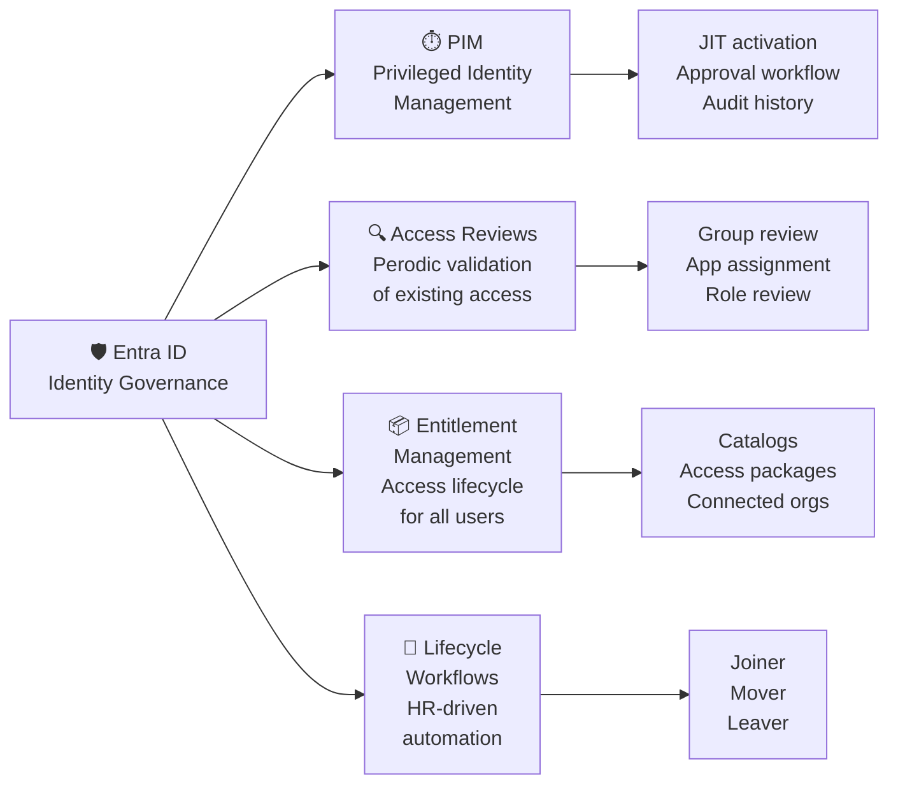

| Pillar | Licence | Core Question Answered |
|--------|---------|----------------------|
| PIM | P2 | Who has privileged access *right now* and why? |
| Access Reviews | P2 | Does this person *still need* this access? |
| Entitlement Management | P2 | How does someone *request and get* access? |
| Lifecycle Workflows | Entra ID Governance (P2+) | What happens *automatically* when someone joins, moves, or leaves? |

---

### ⏱️ Privileged Identity Management (PIM)

**What PIM provides:**

- ⏱️ **Just-in-time (JIT)** privileged access — elevate role only when needed
- 📋 **Approval workflow** — require approval before activation
- 🔐 **MFA on activation** — always require MFA to activate a privileged role
- ⏰ **Time-bound** — access expires automatically
- 📊 **Access reviews** — periodically validate who still needs privileged roles
- 📜 **Audit history** — full log of all activations and changes

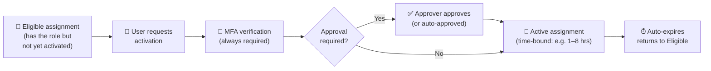

| Concept | Detail |
|---------|--------|
| Licence required | **Entra ID P2** |
| Covers | Entra ID roles (e.g. Global Admin) + Azure RBAC roles |
| Role states | **Eligible** (assigned, not active) · **Active** (currently elevated) |
| Max activation duration | Configurable per role (typically 1–8 hours) |
| Standing access | Anti-pattern — PIM eliminates permanently active admin roles |
| SLA | **99.99%** (standard Entra ID) |

> **Exam Caveats ⚠️:**
> - PIM requires **Entra ID P2** — not available in P1
> - **Eligible** role = person *can* activate it but hasn't yet. **Active** role = currently elevated.
> - Global Administrator is the highest Entra ID role — PIM can require dual approval for it
> - PIM covers both **Entra ID directory roles** (e.g. Global Admin, Security Admin) and **Azure resource roles** (e.g. Owner on a subscription)

---

### 🔍 Access Reviews

Access Reviews provide a structured, recurring process to validate that assigned access is still appropriate — and automatically remove it when it isn't.

**What can be reviewed:**

| Review Target | Who Typically Reviews | Frequency Options |
|--------------|----------------------|------------------|
| Group membership | Group owner, manager, or self | Weekly / Monthly / Quarterly / Semi-annual / Annual |
| Application assignments | App owner or designated reviewer | Same |
| Entra ID directory roles | Security admin or Global Admin | Same |
| Azure resource roles (via PIM) | Resource owner | Same |
| Privileged role assignments | PIM reviewer | Same |

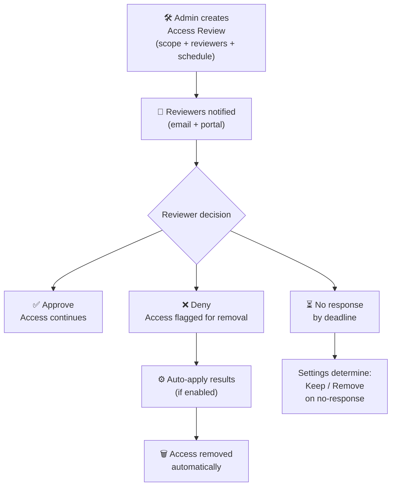

**Key configuration decisions:**

| Setting | Options | Exam Relevance |
|---------|---------|---------------|
| **Reviewers** | Resource owners · Managers · Selected users · Self-review | Self-review = users approve own access (light-touch) |
| **Duration** | 1–180 days | Longer = more time for reviewers; missed reviews = risk |
| **Auto-apply results** | On / Off | Must be On to remove access automatically at close |
| **On no response** | Keep access / Remove access / Take recommendations | "Remove access" = safest; "Recommendations" = ML-assisted |
| **Recommendations** | Based on last sign-in activity | Users with no sign-in in 30+ days flagged for removal |

> **Exam Caveats ⚠️:**
> - Access Reviews require **Entra ID P2**
> - **Auto-apply must be explicitly enabled** — if off, an admin must manually apply review results after the review period closes
> - Access Reviews are **separate from PIM** but they integrate: PIM has its own built-in access review schedule for privileged roles
> - The exam may describe access reviews as "periodic certification of access" — same concept
> - "On no response → Remove" is the recommended setting for security — reviewers who don't act result in access removal, not continuation

---

### 📦 Entitlement Management

Entitlement Management governs **how access is requested, approved, assigned, and expired** for both internal employees and external guests (B2B). It replaces ad-hoc "email your manager to get SharePoint access" processes with a self-service, policy-driven workflow.

**Core objects:**

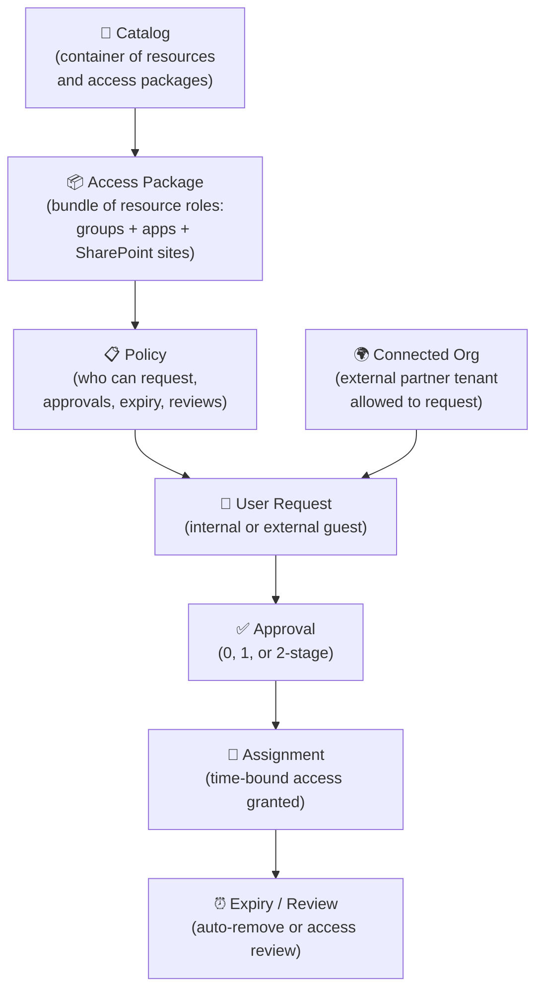

**Key concepts:**

| Object | Description | Exam Signal |
|--------|-------------|-------------|
| **Catalog** | Container grouping access packages and the resources they reference | "Delegate package management to a department owner" |
| **Access Package** | Bundles one or more resource roles into a single requestable unit | "Single request gives access to group + app + SharePoint" |
| **Policy** | Controls who can request, approval stages, max duration, access reviews | "External partners should get 90-day auto-expiring access" |
| **Connected Organization** | External Entra ID tenant or domain allowed to request access packages | "Contractors from partner.com can self-serve project access" |
| **Assignment** | Active access grant from an approved request | Time-bound; renewed by new request or auto-renewal |

**Entitlement Management vs PIM vs Access Reviews:**

| Feature | PIM | Access Reviews | Entitlement Management |
|---------|-----|---------------|----------------------|
| **Focus** | Privileged role JIT activation | Validating *existing* access | Requesting and granting *new* access |
| **Trigger** | User self-activates | Scheduled review | User submits a request |
| **Best for** | Admin / high-privilege roles | Recurring certification of any access | Self-service access requests (employees + guests) |
| **Handles external users?** | ❌ No | ✅ Yes (guest group membership) | ✅ Yes (Connected Organizations) |
| **Licence** | P2 | P2 | P2 |

> **Exam Caveats ⚠️:**
> - Entitlement Management requires **Entra ID P2**
> - **Connected Organizations** are the mechanism for B2B external access requests — the partner doesn't need to be managed by you, just an Entra ID tenant or verified domain
> - Access packages can contain groups, apps, and SharePoint Online sites — but not individual SharePoint files or folders
> - When an access package policy includes an **access review**, the review is triggered automatically at the configured interval — no manual scheduling needed
> - Entitlement Management does **not** replace RBAC for Azure resource access (subscriptions, VMs, etc.); it manages **directory-level and application access**

---

### 🔄 Lifecycle Workflows

Lifecycle Workflows automate identity tasks that need to happen when an employee **joins, moves within, or leaves** an organisation, triggered by HR system attributes (hire date, department change, last day).

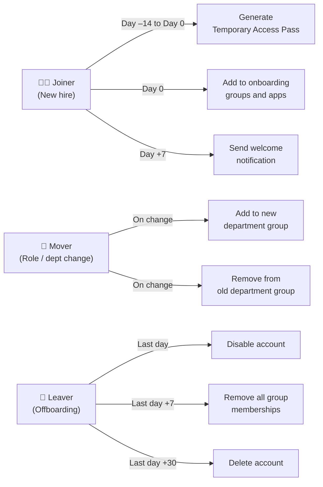

| Aspect | Detail |
|--------|--------|
| Licence required | **Microsoft Entra ID Governance** (superset of P2) |
| Trigger | HR attribute changes (employeeHireDate, employeeLeaveDate, jobTitle) |
| Integration | Works with Workday, SAP SuccessFactors, and other HR connectors via Entra provisioning |
| Task types | Generate TAP · Add/remove group membership · Enable/disable account · Delete account · Send email notification |

> **Exam Caveats ⚠️:**
> - Lifecycle Workflows require the **Entra ID Governance** licence — this is distinct from P1 and P2, though P2 is included within it
> - The key differentiator vs Azure AD provisioning is **temporal triggers**: Lifecycle Workflows act *before* the first day (pre-boarding) and *after* the last day (post-offboarding), not just at the moment of account creation
> - **Temporary Access Pass (TAP)** generation on day-1 is a common Lifecycle Workflows exam scenario — it lets a new hire enrol in MFA without needing a password

---

## 🏛️ 1.4 Design Azure Governance Solutions

### Management Group Hierarchy Design Patterns

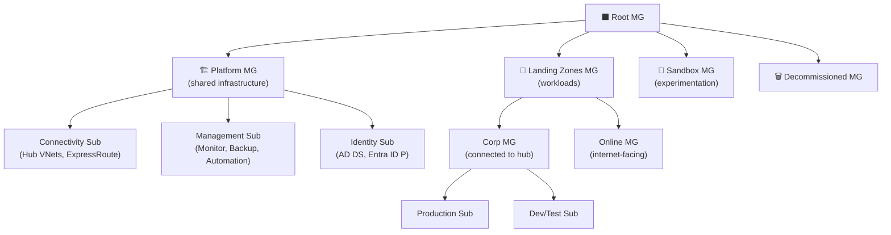

> This follows the **Azure Enterprise-Scale Landing Zone** pattern — the reference architecture Microsoft recommends for large organisations.

### Azure Policy — Effects Ordered by Severity

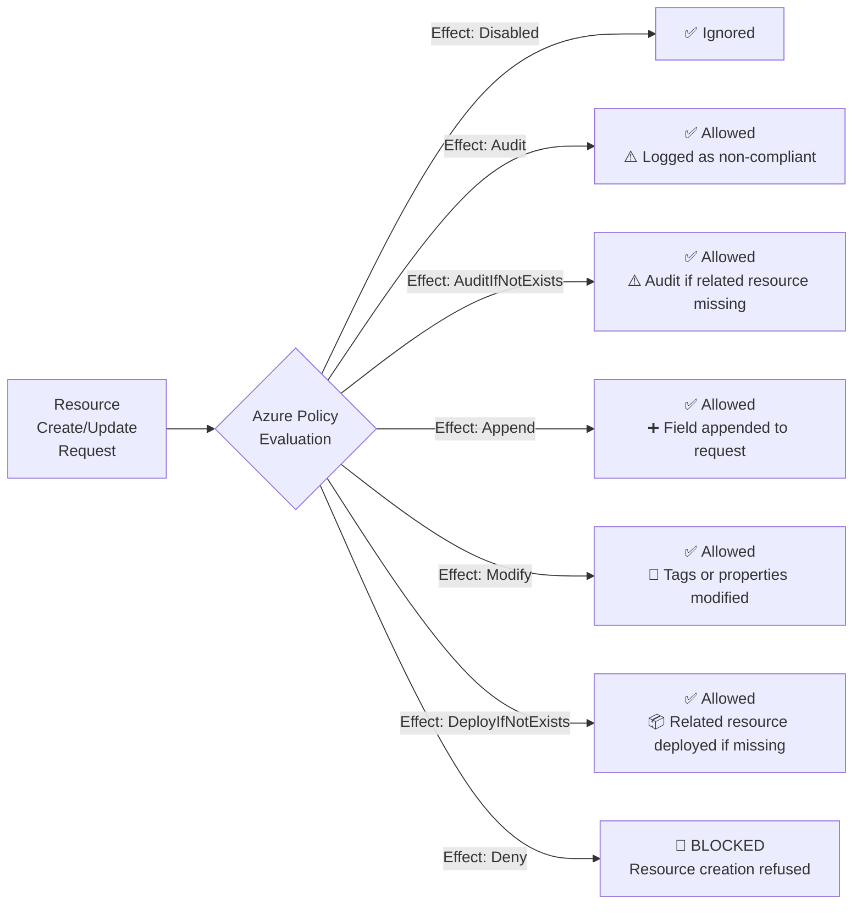

**Policy effects quick reference:**

| Effect | Blocks Creation? | Remediates Existing? | Use Case |
|--------|-----------------|---------------------|---------|
| `Disabled` | ❌ | ❌ | Temporarily turn off a policy |
| `Audit` | ❌ | ❌ | Compliance reporting only |
| `AuditIfNotExists` | ❌ | ❌ | Audit when companion resource missing |
| `Append` | ❌ | ❌ | Add required fields to requests |
| `Modify` | ❌ | ✅ (remediation task) | Enforce tags, modify properties |
| `DeployIfNotExists` | ❌ | ✅ (remediation task) | Deploy companion resource |
| `Deny` | ✅ | ❌ | Hard enforcement — block non-compliant |

> **Exam Caveats ⚠️:**
> - `Audit` logs non-compliance but **never blocks** — resources can still be created
> - `Deny` is a hard stop — plan carefully before applying at scale
> - `DeployIfNotExists` and `Modify` need a **managed identity** to execute remediation tasks
> - Policies assigned at a **Management Group** apply to **all subscriptions underneath** (inheritance)

### Resource Tagging Strategy

**Recommended tag taxonomy:**

| Tag Name | Example Value | Purpose |
|----------|--------------|---------||
| `Environment` | `Production` / `Dev` / `Test` | Filter cost by environment |
| `Owner` | `team-finance@contoso.com` | Accountability and alerts |
| `CostCenter` | `FIN-001` | Chargeback / showback reporting |
| `Application` | `SAP-ERP` | App-level cost aggregation |
| `Department` | `Finance` | Departmental billing |
| `DataClassification` | `Confidential` | Security and compliance |

> **Exam Caveats ⚠️:**
> - Tags do **not inherit** from resource groups to child resources — use Azure Policy to enforce tag inheritance
> - Max **50 tags** per resource
> - Tag values are **case-sensitive** for querying (inconsistent casing breaks reporting)

---

## 📊 1.5 Design Monitoring Solutions

### Azure Monitor Architecture

```mermaid
graph LR
    subgraph Sources["📡 Data Sources"]
        direction TB
        APP["Applications"]
        VM["Virtual Machines"]
        CONT["Containers"]
        RES["Azure Resources"]
        ON["On-premises"]
    end

    subgraph Monitor["📊 Azure Monitor"]
        direction TB
        MET["📈 Metrics\n(time-series,\nnumerical)"]
        LOG["📋 Logs\n(Log Analytics\nWorkspace / KQL)"]
        TRACE["🔍 Traces\n(App Insights)"]
        ACTLOG["📜 Activity Log\n(Azure API ops)"]
    end

    subgraph Actions["⚡ Actions"]
        direction TB
        ALERT["🔔 Alerts"]
        SCALE["⚖️ Autoscale"]
        RUNBOOK["🤖 Automation\nRunbook"]
        LOGIC["🔗 Logic App /\nFunction"]
        ITSM["📟 ITSM\nConnector"]
    end

    Sources --> Monitor
    Monitor --> Actions
```

### Log Analytics Workspace — Design Decisions

| Scenario | Recommendation |
|----------|---------------|
| Single organisation, no compliance constraints | **One workspace per region** |
| Data sovereignty (e.g., must stay in Germany) | **Separate workspace per region** |
| Different retention requirements per workload | **Multiple workspaces** |
| Charge costs back to individual teams | **Multiple workspaces** (or use tags + cost analysis) |
| Security team needs isolated data | **Dedicated security workspace** (for Sentinel) |

> **Exam Caveat ⚠️:** There is a cost to sending data **across regions** to a centralised workspace. For EU data residency, you may need a workspace in each geographic region.

### Application Insights — SKUs & Key Features

| Deployment Mode | Description | Recommended? |
|----------------|-------------|-------------|
| **Workspace-based** (default) | Backed by Log Analytics workspace | ✅ Yes — unified querying |
| **Classic** (legacy) | Standalone, separate storage | ❌ No — being retired |

**Key capabilities:**

| Feature | What it Does | SLA |
|---------|-------------|-----|
| **Availability Tests** | Ping your URL every 5 min from 5+ global locations | **99.9%** |
| **Smart Detection** | AI-based anomaly alerts (no threshold needed) | — |
| **Application Map** | Visual topology of dependencies | — |
| **Live Metrics** | Real-time telemetry stream | — |
| **Failure Analysis** | Drill into failed requests and exceptions | — |
| **User Flows** | How users navigate your app | — |

> **Exam Caveats ⚠️:**
> - Auto-instrumentation requires no code changes (App Service, AKS, Azure Functions) — great for lift-and-shift monitoring
> - **SDK instrumentation** gives more detail (custom events, dependencies) but requires code changes
> - Application Insights data feeds into the **same Log Analytics workspace** in workspace-based mode — unified KQL queries

### Microsoft Sentinel — SIEM & SOAR

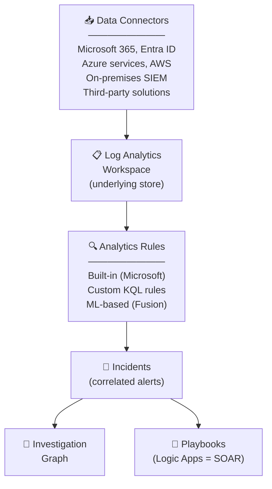

| Feature | Sentinel | Azure Monitor Alerts |
|---------|----------|---------------------|
| Focus | Security threats | Operational issues |
| Data sources | Multi-cloud, on-prem, third-party | Azure-native |
| SOAR automation | ✅ Logic App Playbooks | ✅ Action Groups |
| AI/ML threat detection | ✅ Fusion ML | ❌ Limited |
| Licence required | Sentinel workspace (pay per GB) | Included with Monitor |
| SLA | **99.9%** | **99.9%** |

> **Exam Caveat ⚠️:** Sentinel is built **on top of** a Log Analytics Workspace. You need to provision a workspace first. Costs are based on data ingestion (GB/day) — design data collection carefully to avoid surprise costs.

---

## 🎯 Domain 1 — Exam Scenario Quick-Reference

| Scenario | Answer |
|----------|--------|
| App on Azure VM needs to call Key Vault, no credentials in code | System-assigned **Managed Identity** + **Key Vault Secrets User** role (Azure RBAC) |
| Multiple Azure Functions all need the same permissions | **User-assigned Managed Identity** shared across them |
| Admin needs elevated access only for 2 hours with approval | **PIM** eligible role assignment (requires Entra ID P2) |
| Enforce resource tagging across 50 subscriptions | **Azure Policy (Deny)** assigned at **Management Group** |
| Block VM creation in any region outside EU | **Azure Policy (Deny)** — `allowedLocations` built-in |
| Monitor app performance, failure rates, dependency calls | **Application Insights** |
| Detect suspicious sign-ins and security threats | **Microsoft Sentinel** |
| Require MFA only when sign-in is from outside EU | **Conditional Access** — Named Locations + require MFA |
| User needs read access to a storage account only | **Storage Blob Data Reader** role (RBAC) |
| Audit which resources don't have required tags (no block) | **Azure Policy (Audit)** effect |
| Auto-deploy a Log Analytics agent to all new VMs | **Azure Policy (DeployIfNotExists)** |
| User account flagged as compromised — force password reset | **Identity Protection** User Risk Policy → require password change on high risk |
| Detect sign-in from Tor exit node and block automatically | **Identity Protection** Sign-in Risk Policy (Anonymous IP detection) + **Conditional Access** block on High risk |
| Employee's leaked credential detected — what risk type? | **User risk** (not sign-in risk) — persists on account until remediated |
| Quarterly review of who has access to the Finance app | **Access Reviews** on application assignment, quarterly recurrence, auto-apply |
| Remove stale guest access automatically after 90-day review | **Access Reviews** — on no response: Remove access, auto-apply enabled |
| External contractor needs access to 3 SharePoint sites + 1 app | **Entitlement Management** access package bundling all four resources |
| Partner company employees should self-request project access | **Entitlement Management** + **Connected Organization** for partner tenant |
| New hire should get MFA enrolled before first day, auto | **Lifecycle Workflows** (Joiner) → Generate Temporary Access Pass task |
| Disable account and remove all groups on last day automatically | **Lifecycle Workflows** (Leaver) → Disable account + Remove group memberships tasks |
| Department head needs to certify their team's app access monthly | **Access Reviews** — reviewer = manager, monthly recurrence, self-review option |
| SQL TDE and Storage CMKs must sit in a single-tenant HSM with a customer-controlled root of trust | **Key Vault Managed HSM** |
| Lift-and-shift app on VMs talks to an HSM through PKCS#11 | **Azure Cloud HSM** (successor to Dedicated HSM) |
| Nobody, admins included, may permanently delete the vault that holds CMKs | **Purge protection** (on top of soft delete, which is always on) |
| App Service needs a DB password and must pick up rotated values without a redeploy | **Key Vault reference** (versionless) + **Managed Identity** with Key Vault Secrets User |
| Grant an app read access to secrets without letting Contributors grant themselves access | **Azure RBAC** permission model on the vault (not access policies) |
| Remote users need an on-premises web app with Kerberos SSO, no VPN | **Microsoft Entra application proxy** + Kerberos constrained delegation |
| Replace the VPN for RDP and SMB access to on-premises servers | **Microsoft Entra Private Access** (Quick Access first, then per-app access) |
| Admins sign in to on-premises servers with Entra ID accounts, controlled by Azure RBAC | **Azure Arc-enabled servers** + Virtual Machine Administrator/User Login roles |

---

[← 00 - Azure Prerequisites](/az-305-study-notes/00-azure-prerequisites/) | [02 - Data Storage Solutions →](/az-305-study-notes/02-data-storage-solutions/)
