# 04 — Design Infrastructure Solutions
> **Official Exam Weight: 30–35%** — Heaviest Domain
> 📁 [← Back to Home](/az-305-study-notes/)

---

## 🗺️ Domain Overview

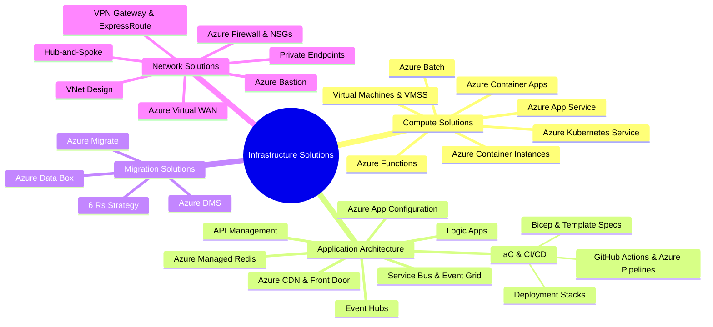

---

## 🖥️ 4.1 Design Compute Solutions

### Compute Service Decision Tree

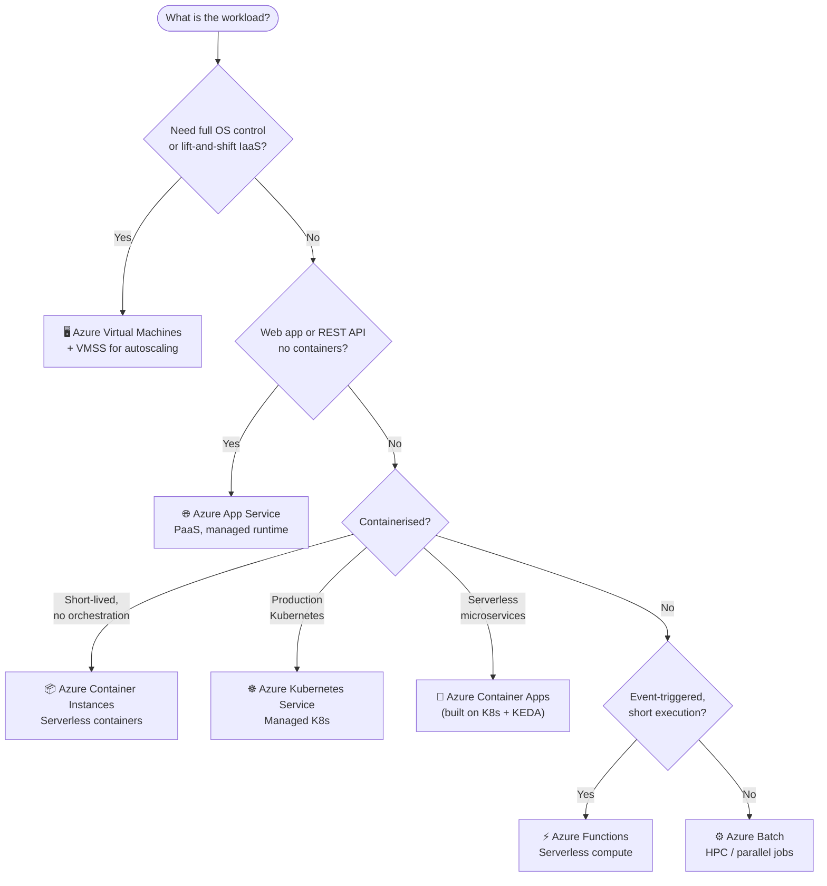

---

### Azure VM Scale Sets (VMSS)

**Key features:**

- 🔢 Scale from 0 to **1,000 VMs** (custom images: 600)
- ⚖️ Autoscale based on metrics (CPU, memory, queue depth) or schedule
- 🔄 **Rolling upgrades** — update VMs in batches to avoid downtime
- 🏗️ Two orchestration modes:

| Mode | Description | Best For |
|------|-------------|---------|
| **Uniform** | All instances identical, same SKU | Stateless workloads, AKS node pools |
| **Flexible** | Mix of VM configs, better fault domain spread | Workloads requiring VM-level flexibility |

> **Exam Caveats ⚠️:**
> - For new VMSS deployments, **Flexible orchestration** is the Microsoft-recommended mode
> - VMSS Autoscale requires **Standard Load Balancer** (not Basic)
> - Define autoscale rules with **cool-down periods** to prevent flapping (scale in/out too rapidly)

---

### Azure Functions — Hosting Plans Comparison

| Plan | Scale | Cold Start | Timeout (Default / Max) | VNet Integration | SLA |
|------|-------|-----------|---------|-----------------|-----|
| **Consumption** | Auto (unlimited) | ✅ Yes | 5m / 10m | ❌ No | **99.9%** |
| **Flex Consumption** | Auto + pre-provisioned | ✅ Reduced | 30m / Unbounded | ✅ Yes | **99.9%** |
| **Premium (EP)** | Auto | ❌ Pre-warmed | 30m / Unbounded | ✅ Yes | **99.9%** |
| **Dedicated (App Svc)** | Manual / auto | ❌ Always on | 30m / Unbounded | ✅ Yes | **99.9%** |
| **Container Apps** | Auto (KEDA) | ✅ Possible | 30m / Unbounded | ✅ Yes | **99.9%** |

> **Exam Caveats ⚠️:**
> - **Consumption plan** cannot use **VNet Integration** — use Premium or Dedicated if needed
> - **Premium plan** eliminates cold starts via pre-warmed instances
> - **Durable Functions** enables stateful workflows across multiple function executions

---

### Azure Kubernetes Service (AKS)

**Key design decisions:**

| Decision | Options |
|---------|---------|
| **Network plugin** | Kubenet (basic, no direct pod IP) vs Azure CNI (each pod gets VNet IP — required for AKS Ingress controllers, policy) |
| **Node pools** | System (K8s system services) + User (your workloads) — separate for isolation |
| **HA** | Availability Zones for node distribution (upgrades to 99.99% SLA) |
| **Autoscaling** | Cluster Autoscaler (nodes) + Horizontal Pod Autoscaler (pods) |
| **Cluster tier** | Free (no SLA) / Standard (99.95%) / Premium (99.95% + LTS) |

**AKS SLAs:**

| Tier | SLA | Notes |
|------|-----|-------|
| **Free** | No SLA | Dev/test only |
| **Standard** | **99.95%** | Production recommended |
| **Standard + Availability Zones** | **99.99%** | Mission-critical production |

> **Exam Caveats ⚠️:**
> - **Azure CNI** is required for: Advanced Networking policies, Windows node pools, Virtual nodes
> - **Kubenet** is simpler but has limitations — use for basic workloads only
> - AKS System node pools **cannot be scaled to 0** — they must always have at least 1 node

---

### Azure App Service — Deployment Slots

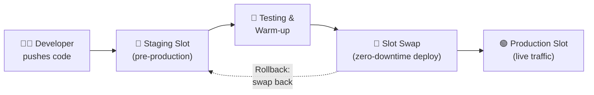

**Slot behaviour:**

- ✅ Slots share the same App Service Plan resources
- 🔁 **Swap** exchanges slot content and settings with zero downtime
- ⚙️ Some settings are "slot-sticky" (stay with the slot) vs non-sticky (swap with deployment)
- 📊 **Traffic routing** — send % of traffic to a slot for A/B testing
- Slots per tier: **Standard = 5**, **Premium = 20**, **Isolated = 20**

---

## 🏛️ 4.2 Design Application Architecture

### Messaging Service Comparison

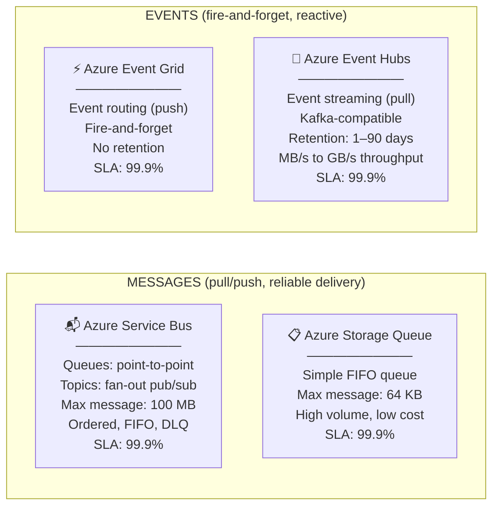
**Detailed comparison — Event Grid vs Event Hubs:**

| Feature | Azure Event Grid | Azure Event Hubs |
|---------|-----------------|-----------------|
| Pattern | Event routing (push) | Event streaming (pull/checkpoint) |
| Retention | None (fire-and-forget) | 1–90 days |
| Consumer model | Push to subscribers | Pull via consumer groups |
| Throughput | Millions of events/sec | Millions of events/sec |
| Ordering | ❌ | ✅ (within partition) |
| Replay | ❌ | ✅ |
| Kafka compat | ❌ | ✅ |
| SLA | **99.9%** | **99.9%** |
| Use when | Trigger serverless functions, webhooks | Log aggregation, telemetry, analytics |

**Detailed comparison — Service Bus vs Storage Queue:**

| Feature | Azure Service Bus | Azure Storage Queue |
|---------|------------------|-------------------|
| Max message size | 256 KB–100 MB | 64 KB |
| Max queue size | 80 GB | Unlimited (storage limit) |
| Guaranteed ordering (FIFO) | ✅ (with sessions) | ❌ Best-effort |
| Dead-letter queue (DLQ) | ✅ | ❌ |
| Duplicate detection | ✅ | ❌ |
| Transactions | ✅ | ❌ |
| Message lock / peek-lock | ✅ | ✅ |
| Pub/sub topics | ✅ | ❌ |
| SLA | **99.9%** | **99.9%** |
| Cost | Higher | Lower |
| Use when | Enterprise messaging, ordering, reliability | Simple, high-volume, cheap queuing |

> **Exam Caveats ⚠️:**
> - **Event Grid** = reactive programming trigger (e.g., blob created → trigger a function)
> - **Event Hubs** = high-throughput streaming (think: Apache Kafka use cases, IoT telemetry)
> - **Storage Queue** = simplest, cheapest; use only when Service Bus features are not needed
> - **Service Bus** = enterprise messaging (reliability, ordering, DLQ, AMQP) — use when message delivery guarantee matters

---

### API Management (APIM) — SKU Comparison

| Tier | Units | SLA | VNet Integration | Self-hosted Gateway | Approx Cost/mo |
|------|-------|-----|-----------------|---------------------|---------------|
| **Developer** | 1 | No SLA | ❌ | ❌ | ~€45 |
| **Basic** | 1–2 | **99.9%** | ❌ | ❌ | ~€145 |
| **Standard** | 1–4 | **99.9%** | External VNet | ❌ | ~€725 |
| **Premium** | 1–31 per region | **99.99%** | Internal & External | ✅ | ~€3,000+ |
| **Consumption** | Serverless | **99.9%** | ❌ | ❌ | Pay-per-call |

> **Exam Caveats ⚠️:**
> - **Premium tier** is required for: Internal VNet mode, multi-region deployments, self-hosted gateway
> - **Consumption tier** has no built-in cache and no VNet support — for low-traffic/dev scenarios
> - **99.99% SLA** requires **Premium** with multi-region (2+ regions) deployment

---

### Azure Managed Redis — Tier Comparison

> ⚠️ **Azure Cache for Redis is retiring.** Azure Managed Redis (AMR) is now GA and the recommended replacement. Basic/Standard/Premium retire **September 30, 2028**; Enterprise/Enterprise Flash retire **March 31, 2027**. Microsoft recommends migrating now rather than waiting.

Azure Managed Redis is built on **Redis Enterprise** software (not the community OSS fork). All tiers support clustering, persistence, and active geo-replication by default — enterprise features that were previously gated behind higher tiers in Azure Cache for Redis.

**Performance tier selection — the new model:**

| Tier | vCPU:Memory Ratio | Storage | Best For | Status |
|------|------------------|---------|---------|--------|
| **Memory Optimized** | 1:8 (most memory per vCPU) | RAM only | Memory-intensive workloads; large datasets, lower throughput needs | GA (≤235 GB); Preview (>235 GB) |
| **Balanced** | 1:4 | RAM only | Standard workloads; healthy mix of memory and compute | GA (≤235 GB); Preview (>235 GB) |
| **Compute Optimized** | 1:2 (most vCPU per GB) | RAM only | Throughput-intensive, high-performance, mission-critical | GA (≤235 GB); Preview (>235 GB) |
| **Flash Optimized** | — | 20% RAM + 80% NVMe | Large datasets at lower cost; read-heavy, infrequently accessed data | Preview |

**SLA and availability:**

| Configuration | SLA |
|--------------|-----|
| High availability disabled (no replication) | No SLA — dev/test only |
| HA enabled (primary + replica across 2 nodes) | **99.99%** |
| HA + deployment across 3+ regions with 3+ AZs | **99.999%** |

**Key architectural details:**

- **Zone redundant by default** when HA is enabled — primary and replica shards placed across AZs automatically
- **~20% memory reserved** per instance as a buffer for replication, failover, and active geo-replication operations
- **Active geo-replication** available on all tiers (was Enterprise-only in Azure Cache for Redis)
- **Clustering on by default** — clients must support Redis Cluster API; nonclustered option available up to 25 GB
- **Flash Optimized**: keys always in RAM, values spill to NVMe; well-suited for read-heavy workloads with large values and a "hot" key subset; not suitable for write-heavy or uniformly random access patterns

**Legacy Azure Cache for Redis — tier mapping for migration:**

| Legacy Tier | Retiring | Recommended Migration Target |
|-------------|---------|------------------------------|
| Basic | Sep 30, 2028 | AMR Balanced (smallest SKU, disable HA for dev/test) |
| Standard | Sep 30, 2028 | AMR Balanced |
| Premium | Sep 30, 2028 | AMR Memory Optimized or Balanced |
| Enterprise | Mar 31, 2027 | AMR Compute Optimized or Balanced |
| Enterprise Flash | Mar 31, 2027 | AMR Flash Optimized |

> **Exam Caveats ⚠️:**
> - **Active geo-replication is no longer Enterprise-only** — it is available on all Azure Managed Redis tiers. The old rule (Enterprise required) applied to Azure Cache for Redis, which is now retiring.
> - **SLA requires HA to be enabled.** Disabling HA halves cost but gives no SLA and risks data loss — dev/test only.
> - **Flash Optimized** is still in **Public Preview** — avoid it as the exam answer when "production" or "GA" is a constraint.
> - **Tiers select by workload profile, not by feature gates.** In AMR, all tiers get clustering, persistence, and geo-replication; tier choice is about the memory-to-compute ratio you need.
> - The exam may still reference Azure Cache for Redis tiers until materials are updated — know both models and watch for context clues (retirement notices, "new deployment", "Azure Managed Redis") to determine which tier model a question uses.

---

### 🧩 Azure App Configuration — Configuration Management

> 📋 **Study guide skill:** *Recommend an application configuration management solution.*

**Where does a setting belong?**

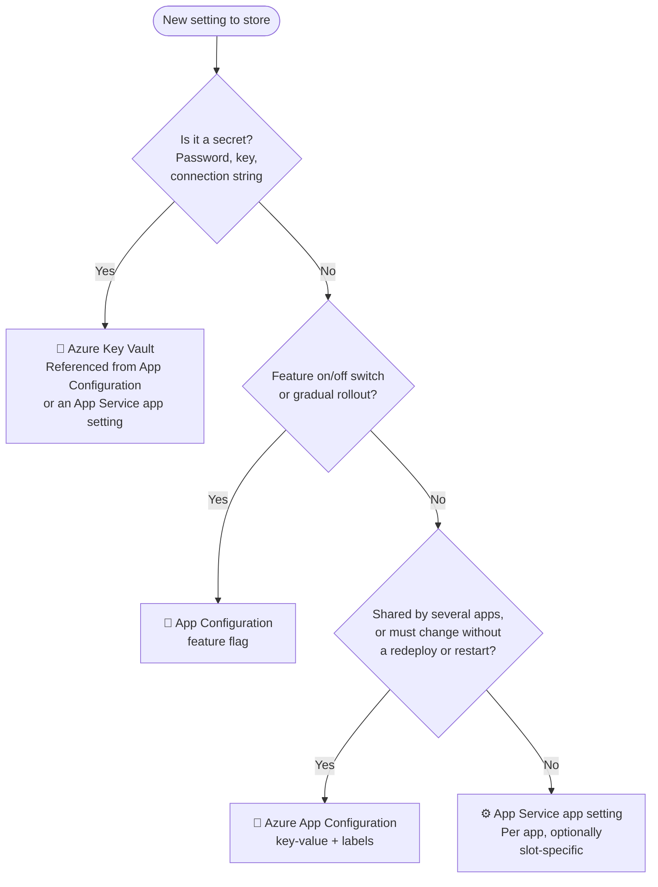

**App settings vs App Configuration vs Key Vault:**

| Dimension | App Service App Settings | Azure App Configuration | Azure Key Vault |
|-----------|-------------------------|------------------------|-----------------|
| Holds | Per-app environment variables | Shared key-values and **feature flags** | **Secrets**, keys, certificates |
| Scope | One app (optionally sticky to a deployment slot) | Many apps on any host: App Service, Functions, AKS, Container Apps, VMs | Any app or Azure service |
| Change without restart | ❌ A settings change restarts the app | ✅ Providers refresh dynamically | Key Vault references refresh within 24 hours |
| Environments | Per app or per slot | **Labels**, or one store per environment | One vault per app per environment |
| History & rollback | ❌ | **Revision history** + immutable **snapshots** | Object versions |
| Right place for secrets? | Encrypted at rest, but no secret management | ❌ Store a **Key Vault reference** instead | ✅ |

**Key features:**

| Feature | What It Does | Why It Matters |
|---------|-------------|---------------|
| **Feature flags** | Switch features on or off at runtime, or target users, groups or a percentage of traffic | Separates **release** from **deployment**: switching a feature off needs no redeploy |
| **Key Vault references** | A key-value that stores the secret's **URI**, not its value | The app resolves the secret from Key Vault with its **own identity**. App Configuration never reads the secret |
| **Snapshots** | An immutable, named, point-in-time set of key-values | Deploy against a known-good configuration, and roll back by pointing at the previous snapshot |
| **Labels** | Variants of the same key (`dev`, `prod`, `v2`) | One store serves several environments when they can share permissions |
| **Geo-replication** | Read-write replicas in other regions, with provider failover between them | Regional resilience, on Standard and Premium only |
| **App Configuration references** | `@Microsoft.AppConfiguration(Endpoint=…; Key=…)` in an App Service or Functions app setting | Existing apps read central configuration with no code change |

**Tiers:**

| Tier | Purpose | SLA | Request Quota | Storage | Geo-replication | Private Link | CMK |
|------|---------|-----|--------------|---------|----------------|-------------|-----|
| **Free** | Evaluation | None | 1,000 / day | 10 MB | ❌ | ❌ | ❌ |
| **Developer** | Low-volume dev/test | None | 6,000 / hour | 500 MB | ❌ | ✅ | ❌ |
| **Standard** | Production | **99.9%** (**99.95%** with geo-replication) | 30,000 / hour | 1 GB | ✅ | ✅ | ✅ |
| **Premium** | High-volume / enterprise | **99.9%** (**99.99%** with geo-replication) | No quota | 4 GB | ✅ (one replica included) | ✅ | ✅ |

> **Exam Caveats ⚠️:**
> - **Don't put secrets in App Configuration.** Store a Key Vault reference instead. The app then needs access to **both** stores: an App Configuration data role (for example, *App Configuration Data Reader*) and a Key Vault role (*Key Vault Secrets User*)
> - App Configuration Key Vault references aren't the same as [App Service Key Vault references](/az-305-study-notes/01-identity-governance-monitoring/#-key-vault--managed-identities--key-vault-references). For a network-restricted vault, or when the app must follow the latest secret version on its own, Microsoft recommends the App Service approach
> - **Feature flags** change behaviour inside one deployment, while [deployment slots](#azure-app-service--deployment-slots) swap whole versions of the app. A scenario can call for either, or both
> - **Free and Developer have no SLA**, so production means Standard or Premium. Geo-replication needs Standard or Premium, and **99.99%** needs Premium **with** geo-replication
> - Access is controlled **per store**. Use separate stores when environments need different permissions, and labels when they don't

---

### 📜 Automated Deployment — Bicep, ARM & Terraform

> 📋 **Study guide skill:** *Recommend an automated deployment solution for applications.* The IaC tool comparison and the CI/CD pipeline stages are in [05 — Infrastructure as Code (IaC) Comparison](/az-305-study-notes/05-well-architected-framework/#infrastructure-as-code-iac-comparison) and [05 — CI/CD Pipeline Patterns](/az-305-study-notes/05-well-architected-framework/#cicd-pipeline-patterns). This section adds the design decisions built on them.

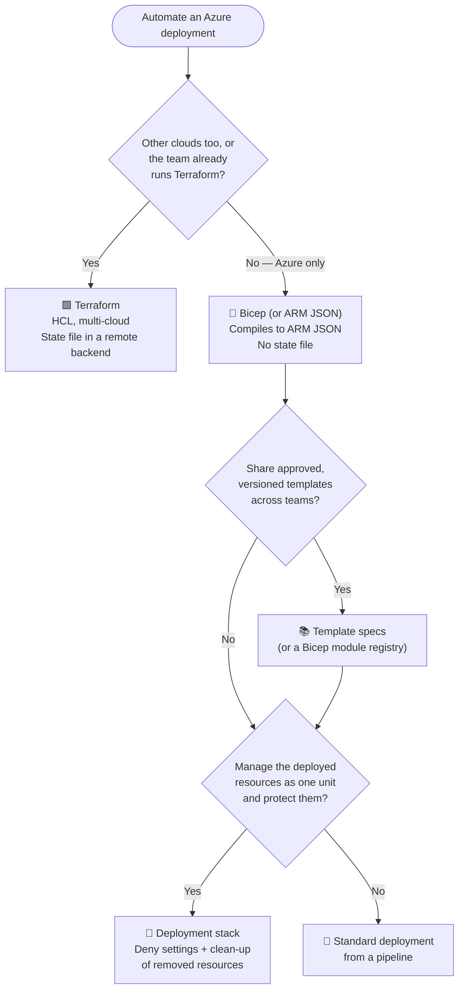

**Template specs vs Bicep module registry vs deployment stacks:**

| Dimension | Template Spec | Bicep Module Registry | Deployment Stack |
|-----------|--------------|----------------------|-----------------|
| Job | **Store and version** an ARM/Bicep template as an Azure resource | **Share Bicep modules** from Azure Container Registry | **Deploy and manage** a set of resources as one unit |
| Consumed by | Portal, CLI, PowerShell, REST, pipelines, Bicep modules | Other Bicep files only | CLI, PowerShell, REST, pipelines |
| Access control | Azure RBAC: **Template Spec Reader** can deploy without editing | Registry RBAC (`AcrPull` to consume) | Azure RBAC + **deny settings** on the managed resources |
| Scope | Stored in a resource group, deploys to any scope | — | Resource group, subscription or management group |
| Lifecycle | Versions only | Versions (tags) only | Create, update, delete. `actionOnUnmanage` **detaches** or **deletes** resources removed from the template |
| Replaces from Azure Blueprints | Blueprint **definitions** | — | Blueprint **assignments** and **locks** |

> ⚠️ **Azure Blueprints retires on January 31, 2027.** A phased retirement started on July 31, 2026, and you can no longer create new blueprint definitions or assignments. Microsoft's replacement is **deployment stacks** (deployment, lifecycle and deny-assignment locks) together with **template specs** or Git (storage and versioning).

> **Exam Caveats ⚠️:**
> - **Bicep and ARM need no state file**, because Azure itself is the source of truth. **Terraform** keeps a state file, so store it in a remote backend such as an Azure Storage account
> - Run **what-if** (`az deployment group what-if`) to preview the changes before a Bicep or ARM deployment
> - **Template specs store, deployment stacks manage.** A template spec on its own doesn't track or protect what it deployed, so use the two together
> - Deployment stack **deny settings** (`denyDelete` or `denyWriteAndDelete`) are deny assignments. They block even Owners, unless those principals are listed in `excludedPrincipals` (up to 5)

### 🔁 Automated Deployment — GitHub Actions vs Azure Pipelines

| Dimension | GitHub Actions | Azure Pipelines |
|-----------|---------------|----------------|
| Lives in | GitHub: YAML workflows in `.github/workflows` | Azure DevOps: YAML (or classic) pipelines |
| Source repos | GitHub | Azure Repos, GitHub, Bitbucket, other Git |
| Authentication to Azure | `azure/login` with **OpenID Connect**, using a federated credential on an Entra app or user-assigned managed identity | **Azure Resource Manager service connection** with **workload identity federation** |
| Approval gates | **Environments** with protection rules (required reviewers, branch limits) | **Environments** with approvals and checks |
| Build agents | GitHub-hosted or self-hosted runners | Microsoft-hosted or self-hosted agents |
| Best fit | Code already on GitHub, marketplace actions | Organisations already on Azure DevOps (Boards, Repos, Artifacts, Test Plans) |

> **Exam Caveats ⚠️:**
> - **Prefer OIDC and workload identity federation over client secrets.** No secret is stored in GitHub or Azure DevOps, so nothing can leak and nothing needs rotating
> - Give the deployment identity the **least-privileged role at the narrowest scope**, for example *Website Contributor* on one app rather than Contributor on the subscription
> - For zero-downtime app releases, deploy to a **staging slot** and **swap**. See [App Service deployment slots](#azure-app-service--deployment-slots)
> - Both tools run the same Bicep or Terraform. Exam answers usually turn on **where the code and the team already are**

---

## 🚀 4.3 Design Migration Solutions

### Migration Strategy — The 6 Rs (+ Retire)

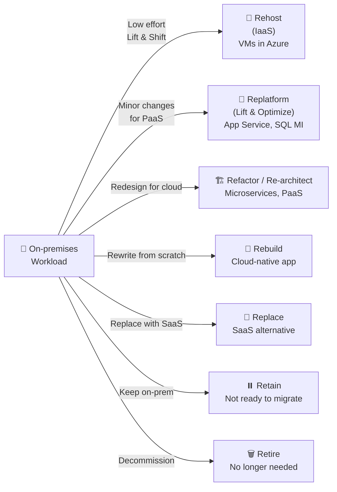

| Strategy | Cloud Benefit | Effort | Time to Cloud |
|----------|--------------|--------|--------------|
| **Rehost** (Lift & Shift) | Low | Low | Fastest |
| **Replatform** (Lift & Optimize) | Medium | Medium | Moderate |
| **Refactor** / **Rearchitect** | High | High | Slower |
| **Rebuild** | Very High | Very High | Slowest |
| **Replace** | Variable | Low | Fast |
| **Retain** | None | None | N/A |
| **Retire** | Cost eliminated | Minimal | Immediate |

> **Exam Caveat ⚠️:** Exam scenarios frequently have budget or time constraints. **Rehost = fastest, lowest risk**. **Refactor = best long-term cloud benefit but most expensive and risky**.

### Azure Migrate — Core Tools

| Tool | Purpose |
|------|---------|
| **Azure Migrate: Discovery & Assessment** | Discover on-prem VMs, assess Azure readiness, estimate costs |
| **Azure Migrate: Server Migration** | Migrate VMware, Hyper-V, physical servers, and cloud VMs to Azure |
| **Azure Database Migration Service (DMS)** | Migrate databases to Azure SQL, MySQL, PostgreSQL |
| **Azure Data Box** | Offline bulk data transfer (40 TB – petabytes) |
| **Azure Data Box Disk** | Offline transfer (up to 35 TB per disk set) |
| **Storage Mover** | Migrate file shares to Azure Files or ADLS Gen2 |

**Azure Migrate Workflow:**

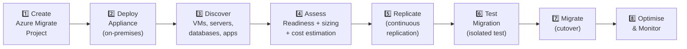

---

## 🌐 4.4 Design Network Solutions

### Connectivity Options Comparison

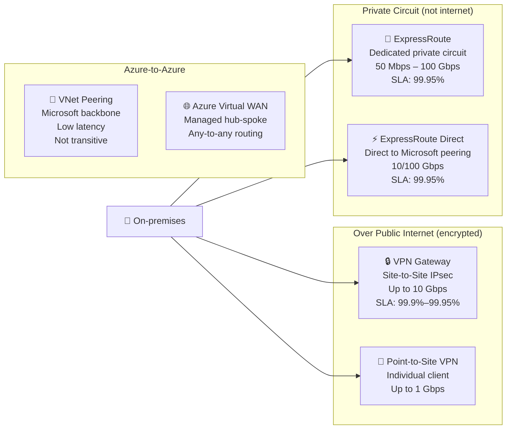

| Option | Private? | Bandwidth | Latency | SLA | Cost |
|--------|---------|-----------|---------|-----|------|
| **Site-to-Site VPN** | ✅ Encrypted | Up to 10 Gbps | Variable | **99.9%–99.95%** | Low |
| **ExpressRoute** | ✅ True private | 50 Mbps–100 Gbps | Consistent, low | **99.95%** | High |
| **ExpressRoute + VPN** | ✅ Both | ExpressRoute primary | Low + failover | **99.95%+** | Highest |
| **VNet Peering** | ✅ (Azure backbone) | Limited by VMs | Very low | Depends on VMs | Low |
| **Azure Virtual WAN** | ✅ | Aggregated | Low | **99.9%** | Medium-High |

> **Exam Caveats ⚠️:**
> - **ExpressRoute** = private circuit, NOT over public internet — for sensitive data, regulatory requirements
> - **VPN Gateway** = encrypted **over** the public internet (still passes through internet infrastructure)
> - **VNet Peering is NOT transitive** — use Azure Virtual WAN or custom route tables for hub-and-spoke transitivity
> - ExpressRoute does **NOT have built-in failover** — pair with VPN Gateway for resilience

### Network Security Layering (Defence in Depth)

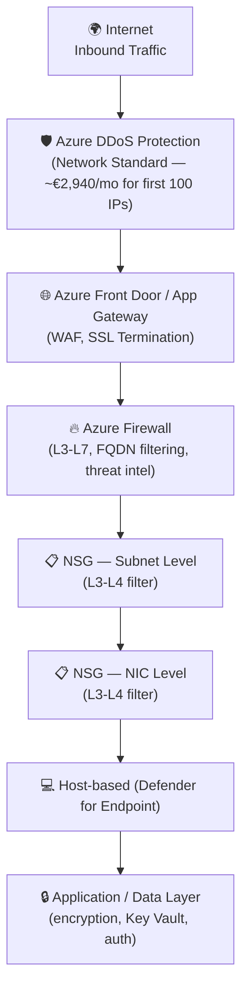

**Azure Firewall vs NSG:**

| Feature | Azure Firewall | NSG |
|---------|---------------|-----|
| OSI Layer | L3–L7 | L3–L4 |
| FQDN filtering | ✅ (e.g., allow \*.microsoft.com) | ❌ |
| Threat intelligence | ✅ | ❌ |
| TLS inspection | ✅ (Premium) | ❌ |
| Stateful | ✅ | ✅ |
| Scope | Centralised (hub) | Per subnet or NIC |
| SLA | **99.99%** | N/A (free service) |
| Approx cost | ~€1,100+/month | Free |

> **Exam Caveats ⚠️:**
> - **NSGs** are free but operate only at L3-L4 (IP/port) — cannot filter by domain name
> - **Azure Firewall** is required when you need FQDN-based rules or threat intelligence
> - In hub-and-spoke, place **Azure Firewall in the hub** and route all spoke traffic through it

### Private Endpoints vs Service Endpoints

| Feature | Service Endpoints | Private Endpoints |
|---------|------------------|-------------------|
| Resource gets private IP in VNet | ❌ (traffic routes via Azure backbone) | ✅ Yes — private IP in your VNet |
| Accessible from on-premises (VPN/ER) | ❌ | ✅ |
| DNS required | ❌ | ✅ (private DNS zone) |
| Cost | Free | ~€7–10/month per endpoint |
| Network path | Azure backbone (still exits VNet) | Stays entirely in VNet |
| SLA impact | None | None (follows service SLA) |

> **Exam Caveats ⚠️:**
> - **Private Endpoints** are required when on-premises resources need to access Azure PaaS services privately (over VPN or ExpressRoute)
> - Service Endpoints do NOT give on-premises resources access to Azure PaaS services
> - Private Endpoints require a **Private DNS Zone** for name resolution to work correctly

### Hub-and-Spoke Network Topology

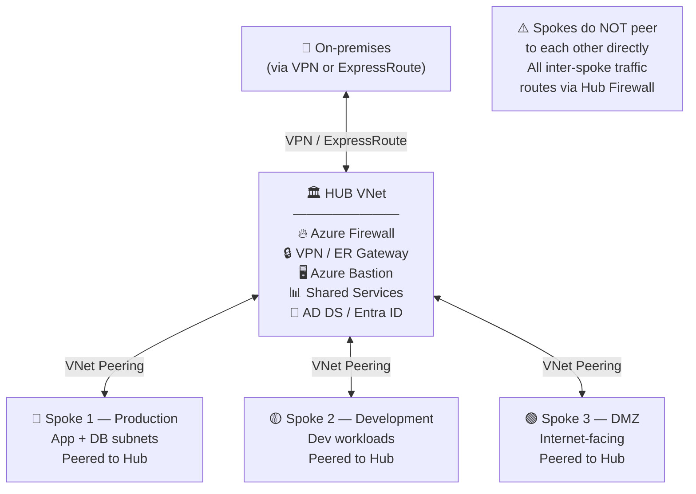

**Hub-and-Spoke design rules:**

- ✅ Spokes peer **only to the hub**, never directly to each other
- 🔥 Use a **User Defined Route (UDR)** in each spoke to force traffic through the Hub Firewall
- 🔒 Hub contains all **shared security services** (firewall, gateway, Bastion, monitoring)
- 💰 Centralising shared services in the hub reduces cost compared to per-spoke duplication

---

## 🎯 Domain 4 — Exam Scenario Quick-Reference

| Scenario | Answer |
|----------|--------|
| Modernise .NET app — minimal code changes, PaaS | **Replatform** → Azure App Service |
| Run containerised microservices at enterprise scale | **AKS** (Standard tier + Availability Zones, 99.99% SLA) |
| Serverless API, no cold start tolerance, needs VNet | **Azure Functions Premium (EP) Plan** |
| Decouple order processing, guarantee message ordering | **Azure Service Bus** (queues with sessions) |
| IoT telemetry ingestion at millions of events/sec | **Azure Event Hubs** |
| Route events from blob upload to trigger a function | **Azure Event Grid** |
| Expose internal APIs to external partners securely | **API Management Premium** (Internal VNet mode) |
| Switch a feature off in production instantly, without redeploying | **App Configuration feature flag** |
| Twenty microservices share settings that change at runtime | **Azure App Configuration** (+ Key Vault references for secrets) |
| Roll back a bad configuration change to a known-good set | **App Configuration snapshot** |
| Central app configuration must ride out a regional outage at 99.99% | **App Configuration Premium** + geo-replication |
| Azure-only IaC with the simplest syntax and no state file | **Bicep** |
| Teams deploy approved, versioned templates but can't edit them | **Template specs** + Template Spec Reader role |
| Deploy a landing-zone baseline and stop anyone deleting it | **Deployment stack** with `denyDelete` deny settings |
| Replace Azure Blueprints before it retires | **Deployment stacks** + template specs |
| GitHub workflow must deploy to Azure with no stored secret | **OIDC** federated credential + `azure/login` |
| Lift-and-shift 500 VMware VMs to Azure | **Azure Migrate (Server Migration)** |
| Migrate 20 TB on-prem SQL Server, minimal downtime | **Azure DMS (online migration)** to SQL MI |
| Transfer 200 TB of files to Azure, internet too slow | **Azure Data Box** (offline transfer) |
| Private connection to Azure — not over public internet | **ExpressRoute** |
| Centrally control all Azure network security (FQDN rules) | **Azure Firewall** in Hub VNet |
| Allow RDP/SSH to VMs without public IPs | **Azure Bastion** |
| Block all traffic except from specific subnets | **NSG with Deny All + specific Allow rules** |
| DDoS protection with analytics and response team | **Azure DDoS Network Protection Standard** |
| Connect multiple Azure regions with any-to-any routing | **Azure Virtual WAN (Standard)** |
| Storage account access from on-premises via VPN | **Private Endpoint** for Storage (not Service Endpoint) |

---

[← 03 - Business Continuity](/az-305-study-notes/03-business-continuity/) | [05 - Well-Architected Framework →](/az-305-study-notes/05-well-architected-framework/)
